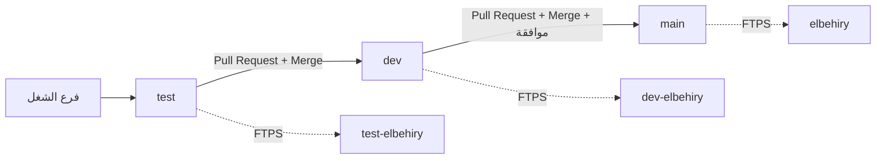

# البحيري CRM: خريطة البنية والحسابات

مرجع واحد لكل بيئة: **الدومين، الفرع، قاعدة البيانات، الحساب، ومسار الرفع**. لا يحتوي أي مفتاح أو كلمة مرور.

## 1) البيئات في نظرة واحدة

| | **Test (تجربة)** | **Dev (تطوير)** | **Main (رسمي)** |
|---|---|---|---|
| الدومين | https://test-elbehiry.engsaber.space | https://dev-elbehiry.engsaber.space | https://elbehiry.engsaber.space |
| فرع GitHub | `test` | `dev` | `main` |
| بيئة GitHub (Environment) | `test` | `development` | `production` |
| مشروع Firebase | **`albehairy-test`** | `albehairy-group` | `albehairy-group` |
| قاعدة Firestore | `(default)` في مشروع test | `(default)` الأصلية | `(default)` الأصلية |
| حسابات الدخول (Auth) | منفصلة | الأصلية | الأصلية |
| مجلد الاستضافة | `domains/test-elbehiry.engsaber.space/public_html/` | `domains/dev-elbehiry.engsaber.space/public_html/` | `domains/elbehiry.engsaber.space/public_html/` |
| بيانات عملاء حقيقية؟ | لا (فارغة) | نعم، نفس الإنتاج | نعم |

> **قاعدة مهمة:** `dev` و`main` على **نفس** قاعدة "البحيري" الأصلية، فأي بيانات تُدخل من dev تظهر في الرسمي. للتجارب استخدم **test** فقط.

## 2) مسار الكود إلى الموقع



- **الترتيب إلزامي:** `test ← dev ← main`. بوابة داخل `.github/workflows/deploy.yml`: لا يُنشر `dev` إلا إذا كان كوده مطابقًا لـ`test`، ولا يُنشر `main` إلا إذا طابق `dev` (تُستثنى `docs/` و`.github/` من المقارنة).
- `main` ينتظر موافقتك على بيئة `production` (فعّل Required reviewers من GitHub ← Settings ← Environments).
- الـ Pull Request يشغّل الفحص فقط (lint + tests + build) ولا ينشر.
- كل فرع يُبنى بإعداد Firebase الخاص به: `test` يضبط `VITE_APP_ENV=test`، والباقي على الإعداد الأصلي (`src/lib/firebaseConfig.ts`).

## 3) قواعد البيانات

| المشروع | المعرّف / الرقم | القاعدة | الموقع | يخدم |
|---|---|---|---|---|
| البحيري (أصلي) | `albehairy-group` / 554596587378 | `(default)` | eur3 | dev + main |
| البحيري (تجربة) | `albehairy-test` / 333010755205 | `(default)` | eur3 | test فقط |

- **لماذا مشروع منفصل؟** قاعدة ثانية داخل `albehairy-group` تتطلب خطة Blaze المدفوعة. المشروع المنفصل مجاني.
- ملفات الإعداد: `firebase-applet-config.json` (أصلي) و`firebase-applet-config.test.json` (تجربة).
- القواعد والفهارس تُنشر على كل مشروع بشكل منفصل:
  ```bash
  firebase deploy --only firestore --project albehairy-test
  firebase deploy --only firestore --project albehairy-group   # بحذر: إنتاج
  ```
- قاعدة test تبدأ فارغة: أول فتح يعرض شاشة «الإعداد لأول مرة» لإنشاء حساب المطوّر.

## 4) الحسابات والخدمات

| الخدمة | الاستخدام | الحساب / المعرّف | الرابط |
|---|---|---|---|
| **GitHub** | الكود وAction | المالك `SaberGD`، مستودع `El.-Behery-CRM` (خاص) | https://github.com/SaberGD/El.-Behery-CRM |
| **Hostinger** | الاستضافة ونطاق `engsaber.space` | مستخدم الاستضافة `u570689065`، طلب (Order) `1008405228` | https://hpanel.hostinger.com |
| **Firebase** | Firestore + Auth | albehairygroup@gmail.com | [albehairy-group](https://console.firebase.google.com/project/albehairy-group) · [albehairy-test](https://console.firebase.google.com/project/albehairy-test) |
| **Google Cloud** | نفس مشروعي Firebase (فوترة، مفاتيح خدمة) | نفس حساب Firebase | https://console.cloud.google.com |
| **Google AI Studio** | مفتاح Gemini لميزات الذكاء الاصطناعي (زكي) | حسابك على AI Studio | https://aistudio.google.com/apikey |

بريد حساب Hostinger: _اكتبه هنا_.

## 5) أسرار وملفات خارج الكود (لا تُرفع على GitHub)

| ما هو | أين | مَن يستخدمه |
|---|---|---|
| `FTP_SERVER` / `FTP_USERNAME` / `FTP_PASSWORD` | GitHub ← Environments (`production`، `development`، `test`) | نشر FTPS |
| `crm-ai-secrets.php` (مفتاح Gemini) | `domains/<الموقع>/` بجانب `public_html` | زكي، الكتابة الصوتية (`api/ai.php`) |
| `crm-firebase-admin.json` (مفتاح خدمة) | `domains/<الموقع>/` بجانب `public_html` | إعادة تعيين كلمات المرور وحذف الموظف (`api/admin.php`) |

- ملف الذكاء الاصطناعي موجود على dev وtest. مفتاح الخدمة الخاص بـ`albehairy-test` غير موجود، فإدارة الحسابات من الخادم لا تعمل على test.
- تفاصيل الإعداد: `ai-setup.md` و`admin-setup.md`.

## 6) حالة الإعداد الحالية

- [x] نطاق test وقاعدته المنفصلة وزكي يعملون.
- [x] تصحيح مساري `main` و`dev` وبوابة الترتيب موجودان في `deploy.yml`.
- [ ] **GitHub Actions متوقف:** كل التشغيلات تفشل قبل البدء بسبب دفعات الحساب أو حد الصرف (Settings ← Billing and plans). حتى يُحل لا يوجد نشر تلقائي، ويُرفع الموقع يدويًا.
- [ ] أسرار FTP في بيئة `test`.
- [ ] تفعيل Required reviewers لبيئة `production`.

## 7) الوثائق الأخرى

[DEVELOPMENT.md](DEVELOPMENT.md) الفروع والأوامر · [admin-setup.md](admin-setup.md) الأدوار وكلمات المرور · [roles-and-permissions.md](roles-and-permissions.md) · [ai-setup.md](ai-setup.md) · [backups.md](backups.md) · [security-review.md](security-review.md) · [pwa.md](pwa.md)

> GitHub يرسم مخطط Mermaid تلقائيًا في صفحة الملف.
